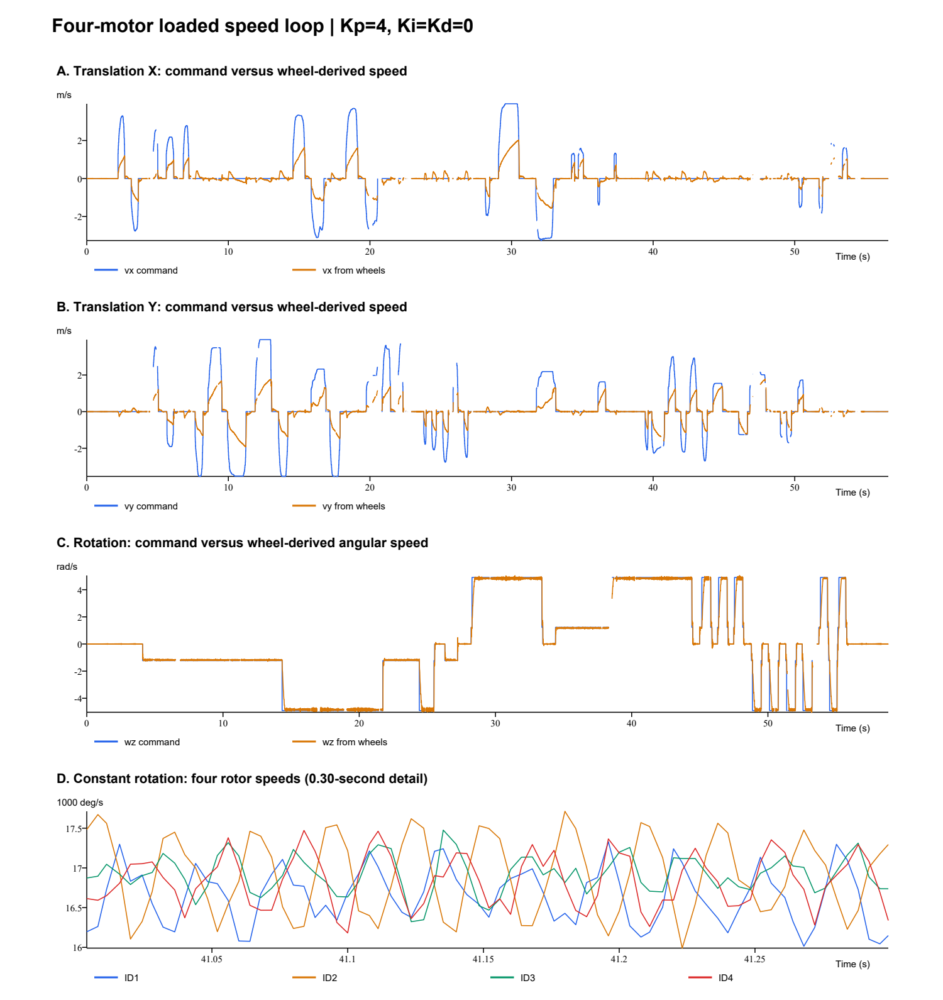

# M3508 + C620 四电机带载速度环：定量分析与共用 PI 设计

2026-10-13。用户确认电调为 C620，要求平动响应优先、转动次要，四电机共用参数。第一版实机验证参数为 **Kp=1.8、Ki=8.0、Kd=0、IntegralLimit=6000、MaxOut=16000**。用户随后要求将其写入当前参数，已更新 `robot_config.h` 的四轮共用模板；尚未烧录或实机验证，不能称为实车全局最优参数。

## 数据和硬件依据

- 输入为用户桌面 `平动.csv` 和 `转动.csv`，均为四电机 VOFA 页 5。原文件未修改，SHA256 和全部指标见同目录 `results.json`。
- M3508 手册：`doc/大疆/RoboMaster M3508直流无刷减速电机使用说明V1.0（中英日）.pdf`，中文第 12～13 页：C620/24 V 条件下输出轴空载 482 rpm、额定 469 rpm、额定输出转矩 3 N·m；特征表给出转矩常数 0.3 N·m/A、机械时间常数 49 ms、相电阻 0.194 Ω、相电感 0.097 mH、减速比 3591/187≈19.2032。
- C620 手册：`doc/大疆/RoboMaster C620无刷电机调速器使用说明（中英日）V1.01.pdf`，中文第 32～33 页：指令 ±16384 对应 ±20 A 转矩电流，反馈是转子 RPM，默认反馈 1 kHz。
- 所以指令码值 `u/819.2` 转为 A；程序速度环反馈为转子 deg/s，等于 RPM×6。MaxOut=16000 对应约 19.53 A，IntegralLimit=6000 对应约 7.32 A。电调支持的电流上限不等于电机可长期承受的电流。
- M3508 表中额定 10 A 的脚注说明为电调输入端电流，不能拿它直接替代 CAN 转矩电流上限。49 ms 为手册测试条件下的机械时间常数，不能直接当作装车后的电流到速度时间常数。L/R≈0.5 ms 也不是已经确认的闭环电流响应时间。
- 绝对转矩/惯量换算仅用于物理量级检查；实际拟合和 PI 参数在项目原有的电流码值单位下进行。项目减速比仍为 19，本轮没有改运动学参数。

## 采集质量

| 项目 | 平动 | 转动 |
| --- | ---: | ---: |
| 记录点数 | 12694 | 14021 |
| 记录时长 | 56.608 s | 58.836 s |
| 时隙缺失比例 | 10.31% | 4.68% |
| 最大记录空档 | 516.1 ms | 360.0 ms |
| 正常采样间隔中位数 | 4 ms | 4 ms |
| 已记录的最大 PID dt | 2.1 ms | 2.3 ms |

所有已记录点四电机在线、使能，速度外环 active 为 0。不能把这些快照当作未记录时段也正常的证明。缺失时隙可能来自无线、采集端或调度，现有字段不能唯一归因。阶跃/频谱分析只使用对应连续窗口，不跨丢帧空档补线。

实际目标也不是完整的预定波形：平动 X/Y 分量最高约 3.934 m/s，旋转只有 0、±1.226、±4.904 rad/s，未覆盖 6 rad/s。以下平动速度、转动角速度均为当前运动学对轮速的反算，不是外部地速真值。



A/B 是平动指令与轮速反算；C 是旋转指令与轮速反算；D 是恒定旋转时 0.30 s 的四电机转子速度细节。图中各文件横坐标从该文件首点计时，缺失间隔不连接。

## 当前 P=4 的表现

### 平动大误差主要伴随输出饱和和下游限功率

统计条件：电机在线/使能，底盘有非零运动目标且对应轮目标绝对值>1000 deg/s；占比按有效记录点计，不是按所有时间的严格积分。

| 电机 ID | PID 达到 ±16000 的比例 | PID 输出与下游指令不同的比例 | 反馈电流 RMS，沿用项目换算 |
| --- | ---: | ---: | ---: |
| 1 | 85.90% | 97.74% | 5.76 A |
| 2 | 79.20% | 97.72% | 5.77 A |
| 3 | 81.69% | 97.74% | 5.41 A |
| 4 | 80.62% | 97.72% | 5.67 A |

只取目标平动幅值 1～2 m/s 的 1806 个有效点，PID 饱和仍约为 58%～78%，下游指令改变约 92.97%。这些点含加减速，不应称作稳态误差。

按当前代码的功率公式重算：有效平动点中，削减前估计总功率中位数约 583.6 W，削减后约 119.98 W，与当前 120 W 上限一致。这里是**代码模型的估计值**，不是裁判系统/电源的实测功率。说明很多时刻已经由功率控制决定实际电流，继续增大 P 对这些时刻不会增加实际驱动力。

平动三个持续>0.5 s 的恒定目标片段都在约 3.52～3.93 m/s，尾段四轮仍全部 PID 饱和。因此不能以这几个片段的 46%～66% 跟随偏差直接推导更大的 P 或 I。

### 转动平均跟随较好，存在可重复波动

从恒定目标≥1 s 的片段去掉前 0.3 s 后，平均速度低于目标的百分比：

| 目标 wz | ID1 | ID2 | ID3 | ID4 |
| --- | ---: | ---: | ---: | ---: |
| +4.904 rad/s | 2.46% | 1.19% | 0.90% | 1.26% |
| -4.904 rad/s | 1.38% | 0.77% | 1.87% | 1.68% |
| +1.226 rad/s | 4.41% | 3.95% | 3.62% | 3.55% |
| -1.226 rad/s | 4.09% | 3.54% | 4.17% | 4.31% |

没有一个电机在所有方向都最差，继续用一组参数合理。高档正转 ID2 的速度标准差约 514 deg/s，ID1/3/4 分别约 389/258/376 deg/s。

连续、未丢帧、恒定高档正转的多个 2 s 窗口，经去线性趋势、Hann 窗和 FFT 后，ID1/2/4 主峰在约 34～34.5 Hz。ID2 的单个主峰频率格点约占 2～100 Hz 带内功率的 55%。这是重复波动的证据，但不能仅凭闭环频谱证明其全部来自 PID，或把输出/反馈比直接当作对象的开环频响。

## 装车模型如何得到

四轮在地面相互耦合，不能将四个电机当作完全独立空载对象。首先按已有运动学，将电机速度和电流分别投影到 X、Y、旋转三个正交运动方向；再用电流和速度的积分关系拟合：

\[
\dot v = g u-a v-c\operatorname{sgn}(v)+d
\]

其中 v 是该运动方向的等效转子速度（deg/s），u 是该方向的等效转矩电流码值，g 是加速度增益，a 是等效阻尼，c/d 表示摩擦和方向负载差异。

使用实测电流字段；使用 40 ms 的积分增量降低差分放大噪声。仅使用时隙连续、符合单轴主导条件的窗口，不填补缺失。约束 g>0、a≥0、c≥0；无约束拟合出现的负阻尼模型被拒绝。时间前半段拟合、后半段检验。相邻窗口重叠，不能用窗口数当作独立样本数计算虚假的高置信区间。

| 工况 | g，(deg/s²)/码值 | a，1/s | 拟合 R² | 后半段检验 R² |
| --- | ---: | ---: | ---: | ---: |
| X 平动 | 10.43 | 0（落在约束边界） | 0.623 | 0.530 |
| Y 平动 | 11.45 | 0（落在约束边界） | 0.714 | 0.741 |
| 旋转 | 24.42 | 0.746 | 0.748 | 0.750 |

R² 指的是积分速度增量的解释度，不是整车速度精度，也不是长期自由运行预测误差。X 拟合质量中等，平动存在限幅、轮载变化和未建模耦合，不能过分相信小数点后的系数。

旋转时分别对四电机做同样的局部拟合，g 约为 ID1=25.45、ID2=23.46、ID3=26.27、ID4=21.09。改变积分窗口到 12～80 ms 后，加速度增益约落在 8～35，设计扩展至 8～40 作为工程敏感性范围；该范围不是统计置信区间。

按手册名义转矩常数、几何和减速比换算，X/Y 模型对应的等效平动质量约 13.2/12.0 kg。这包含轮系等效惯性及拟合误差，只作量级检查，不能当作机器人实际称重结果。

## 共用 PI 参数和选择依据

```c
.speed_PID = {
    .Kp = 1.8f,
    .Ki = 8.0f,
    .Kd = 0.0f,
    .IntegralLimit = 6000.0f,
    .MaxOut = 16000.0f,
    .DeadBand = 0.0f,
    .Improve = PID_Trapezoid_Intergral | PID_Integral_Limit |
               PID_Derivative_On_Measurement,
},
```

参数对应现有 `PIDCalculate()`：误差为转子 deg/s，输出为电流码值，积分实际乘以秒单位 dt。若改成 RPM 误差，对应 Kp=10.8、Ki=48；不要把其他工程没有 dt 的 Ki 直接复制过来。

具体筛选流程：

1. 将 X/Y 平动各占 40%、转动占 20%，反映平动优先。每个工况的代价由 60% 小扰动目标跟随、40% 负载阶跃恢复组成，计算前 1 s 归一化绝对误差积分。负载阶跃取等效 1000 码值≈1.22 A，目标阶跃取 1000 deg/s，属于实际工作点附近的小扰动，不能外推成从静止到 2 m/s 的完整加速。
2. 电流动态用一阶环节近似，时间常数假设为 0.5～2 ms；有效延迟取 2～8 ms，包含约 2 ms CAN 输出保持。记录高档电流/指令的局部频谱比对应约 2.8～3.4 ms 的纯延迟等效量，但不能将它当作完整硬件延迟或最坏耗时；8 ms 是工程敏感性假设。
3. 用 g=8～40、a=0～1.5 的模型族检查相位裕度≥45°。要求名义平动小扰动超调≤15%、名义转动≤25%，以及最不利假设离散仿真超调≤30%。这些阈值是本次设计选择，不是用户给出的验收指标。
4. 网格搜索 Kp=1.4～2.5、步长 0.1，以及 Ki=0～20 的多组候选。网格内最小代价为 Kp=1.8、Ki=8.8；第一轮实机建议把 Ki 向下取整至 8.0，避免刚好贴住有限精度模型的超调约束。这是指定模型、网格和权重下的结果，不是对真实系统的全局最优证明。
5. Ki/Kp≈4.44 1/s，即积分时间约 0.225 s，着重消除平动带载时的持续速度偏差。Kd=0，避免在已有反馈波动和未辨识高频动态下引入额外微分放大。

推荐模型族的预测交越频率约 2.38～11.47 Hz，最小相位裕度约 45.6°、最小增益裕度约 7.1 dB。它们都是上述一阶加延迟近似的计算值；34 Hz 机械/控制耦合峰未被精确建模，所以不能把这些数值当作实机稳定性已被证明。

## 预测效果与必须区分的限制

名义模型、3 ms 传输延迟、1 ms 电流环时间常数、1 ms PID、2 ms CAN 保持下，工作点附近 1000 deg/s 小阶跃预测：

| 工况 | 10%～90% 上升时间 | 超调 | 进入并保持 ±2% 的时间 |
| --- | ---: | ---: | ---: |
| X 平动 | 70 ms | 13.9% | 0.581 s |
| Y 平动 | 64 ms | 13.1% | 0.560 s |
| 旋转 | 30 ms | 6.3% | 0.350 s |

数值来自模拟，不是实机新参数测量。模型没有重现 34 Hz 峰、精确电调内环、轮胎滑移、共享功率限制或温升，不能用这些表值承诺实际到 2 m/s 的时间。

负载阶跃仿真中，原 P=4 最终保留约 250 deg/s 偏差；新 PI 在约 1 s 时降至约 2 deg/s（X/Y），前 1 s 误差积分约减半。但新 PI 的初始负载扰动峰值反而更大：约 428～435 deg/s，原 P 约 250 deg/s。降低 P 是为保留共用环稳定余量，积分改善的是持续偏差和恢复，不能宣称它在每一种瞬态上都比 P=4 更快。

平动日志大部分时间限功率，新 PI 不能突破 120 W 和电机电流能力。原 PID 只对自身 ±16000 输出做积分限制，不知道下游功率削减；本轮不修改 Modules。故须特别检查持续限功率后回零、换向的积分恢复，IntegralLimit=6000 也不能替代对实际执行电流的抗积分饱和。

第一轮验证应在实际 1～2 m/s 平动及 3～6 rad/s 旋转范围内采集同样四电机页：优先比较平动 1↔1.2、1.7↔2.0 m/s 的工作点阶跃、稳态偏差和回零；旋转检查是否出现增长振荡或明显恶化。现有数据没有 6 rad/s 的验证结果。若转动峰仍明显，应通过新数据缩小参数范围，不能仅凭这次模型继续提高 P。

## 可复现文件

- `Utils/analysis/analyze_motor4_logs.py`：采样完整性、限幅、稳态、连续窗口阶跃和频谱分析。
- `Utils/analysis/design_motor4_pid.py`：有约束积分模型、时间切分检验、加权网格选择和延迟敏感性仿真。
- 同目录 `results.json`、`modal_fits.json`、`pid_design.json` 保存原始文件哈希、拟合参数、候选排序和仿真结果。

分析阶段未修改机器人参数。随后按用户要求，将上述 PI 和积分限幅写入机器人四轮共用配置；Modules 和原 CSV 未改写。三轴速度外环仍关闭，保留四电机 250 Hz 调参采集。
