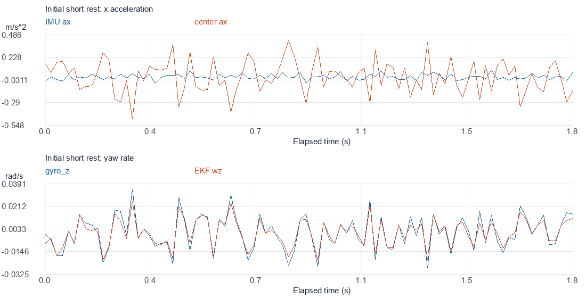
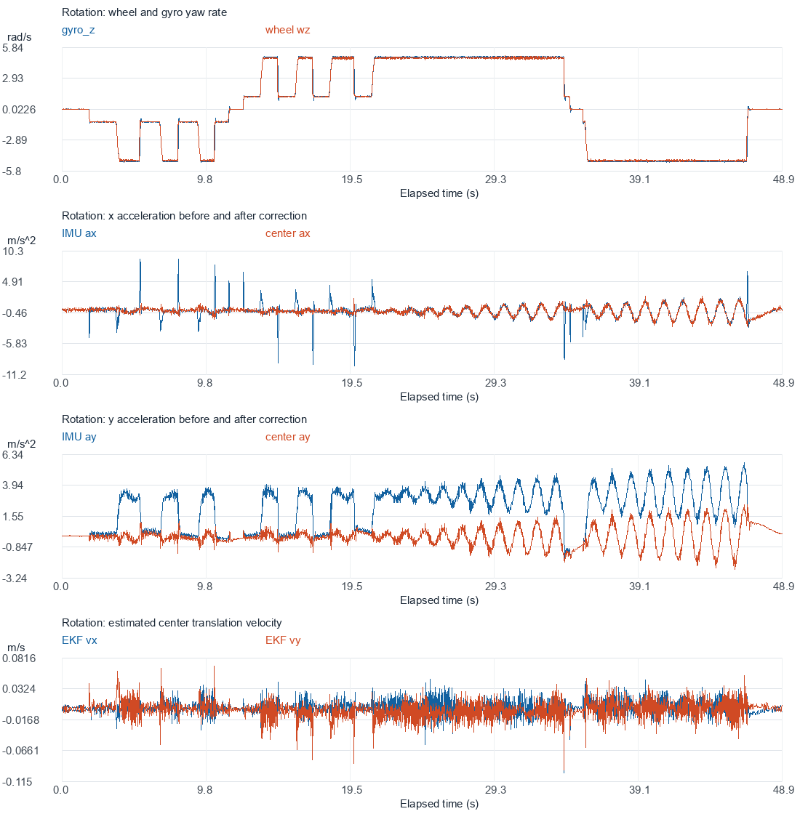
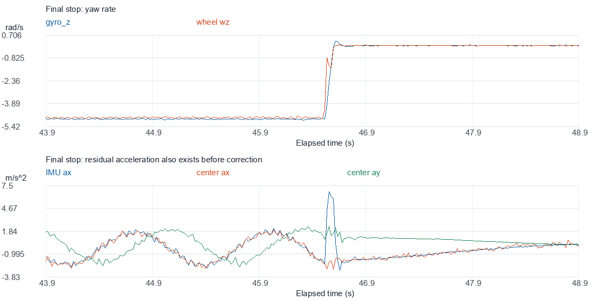

# 匹配低通改进后的转动验证：new.csv

用户确认本记录为顺逆转动，包含短暂停转，不包含主动平动。分析按转动和各停转段分开，不把整段数据的标准差作为静止噪声。当前报告只分析数据，没有修改固件、Q/R、PID 或 Modules。

后续补充：用户已确认机械/云台偏心会引起真实车体平移，本轮后续整定按真实运动保留，不消除其周期加速度。该历史报告中的待辨别判断不是本轮删减输入的依据。已应用参数及验证见 [整定说明](../2026-10-12-tuned/整定说明.md)。

**结论：角加速度噪声放大的问题明显改善；但持续转动后出现随转角变化的低频加速度残差，尚不能确定整套融合输入已经可靠。下一步优先检查姿态/去重力及真实周期摆动，不能只继续调卡尔曼方差。**

## 1. 数据完整性

- 原始文件：`C:/Users/Dai/Desktop/new.csv`，2444 行、25 通道、48.8600 s。
- 全部数值有限，采集序号连续，没有缺失 20 ms 时隙。相邻记录间隔为 18.8～21.2 ms。
- 温度 39.50～39.75°C。被记录的时刻 gyro、中心加速度、观测器更新和融合反馈有效，四电机在线、速度外环启用、底盘未处于 POWER_OFF。
- 11 个记录时刻（0.45%）没有满足四轮同时为新样本，不等于电机离线。
- 数据形态与本次匹配低通改动的预期相符，但日志未携带固件版本号，不能仅凭 CSV 独立证明烧录的具体版本。

时间均表示相对本文件开始的时间。未插值补帧，通道 2 的约 1 ms EKF 步长未用作 CSV 相邻记录间隔。

## 2. 停转段：角加速度噪声放大明显减小

候选停转条件为 `|gyro_z|<0.06 rad/s`、`|wheel_wz|<0.08 rad/s`、`max(|wheel_vx|,|wheel_vy|)<0.025 m/s`，连续不少于 0.8 s。转动后的停转段先去掉前 0.4 s。这里只说明轮速/角速度较小，不保证姿态和去重力已经恢复稳态。

| 分段 | 用于统计的时间 | 点数 | center_ax 均值 / 标准差 | center_ay 均值 / 标准差 |
| --- | --- | ---: | ---: | ---: |
| 起始停转 | 0～1.8204 s | 92 | 0.00162 / **0.18868** | 0.00234 / 0.01312 |
| 中间停转 | 11.82～12.28 s | 24 | -0.00059 / 0.18404 | **-0.20118** / 0.03192 |
| 最后停转，仍在恢复 | 47.16～48.86 s | 86 | **-0.42524** / 0.55145 | **0.56013** / 0.26388 |

加速度单位为 m/s²；表中的均值与随机波动分开记录。三个停转段不能直接合并：最后一段仍有明显趋势，中间 y 方向也有残余均值。

起始短停转与上一组完整静止数据对比：

| 指标 | 改进前静止日志 | 本次起始停转段 |
| --- | ---: | ---: |
| gyro_z 标准差，rad/s | 0.012584 | 0.013619 |
| IMU 点 ax 标准差，m/s² | 0.029842 | 0.031881 |
| **中心 ax 标准差，m/s²** | **2.041927** | **0.188682** |
| 中心 ax 方差，(m/s²)² | 4.169465 | 0.035601 |
| 中心 ay 方差，(m/s²)² | 0.00014949 | 0.00017206 |

中心 ax 标准差约降低 **10.8 倍**，方差约降低 **117 倍**。从补偿项反推的角加速度标准差约从 15.30 降至 1.46 rad/s²，也支持差分噪声得到抑制。补偿前的 ax 波动量级接近，说明结果不只是原始 ax 变安静。

这是不同采集轮次的初步比较，不是同一输入的严格对照回放。新的平稳停转段仅约 1.8 s，其他机构状态是否完全一致未单独确认，不能替代完整工作噪声标定。匹配低通后 center_ax 仍比 IMU 点 ax 更嘈杂，不能理解为噪声已经消失。



## 3. 转动尺度和方向保持一致

沿用上一组的稳定转动选择条件：连续 21 个时隙内 `|gyro_z|>1 rad/s`、gyro_z 峰峰值小于 0.12 rad/s。选择 1580 点，得到：

```text
gyro_z ≈ 1.02013 * wheel_wz + 0.00351 rad/s
相关系数                0.999889
拟合残差 RMS            0.06732 rad/s
直接 gyro-wheel 差值 RMS 0.11207 rad/s
```

上一组对应斜率为 1.02015，差值 RMS 为 0.10408 rad/s。本次仍约有 2% 的尺度差异，未发现 √2 倍误差。正转和反转分别拟合的斜率约为 1.01932、1.01790。此次输入滤波改动没有改变轮速运动学尺度，也没有证据表明造成了角速度方向错误。

中心平移估计在稳定转动样本中的标准差为 vx 约 0.01238 m/s、vy 约 0.01422 m/s。没有独立定位，不能把它们直接认定为实际平移误差；车体可能存在微小真实移动，轮速也可能有滑移。



## 4. 新发现：每转一圈出现一次明显加速度变化

整段图中约 25 s 以后，IMU 点和中心加速度都出现明显低频周期变化，后半段幅度增大。它已经存在于 `MotionAccel_b`，不能归因于新增杆臂滤波单独制造了这段变化。

为检查与转动的关系，用 gyro_z 按 CSV 实际时间做梯形积分得到相对转角 θ，在两段相对稳定转动窗口内拟合：

```text
accel = mean + b*sin(theta) + c*cos(theta)
幅值  = sqrt(b²+c²)
```

这个 θ 是日志陀螺仪积分得到的诊断参考，不是外部角度真值。

| 窗口 | 平均每秒转圈数 | center_ax 同步分量幅值 | center_ay 同步分量幅值 | 同步拟合解释的方差 x/y |
| --- | ---: | ---: | ---: | ---: |
| 25～30 s | 0.7859 Hz | 0.8130 m/s² | 0.8016 m/s² | 79.1% / 82.0% |
| 40～45 s | 0.7845 Hz | 1.9097 m/s² | 1.8862 m/s² | 95.6% / 97.4% |

这说明后半段的大部分加速度变化与转角同步，并非普通白噪声；x/y 的同步分量相位相差接近 90°。可能涉及姿态/去重力误差在机体系中的投影，或真实的惯性系周期运动、摆动等。现有 25 路没有姿态、带重力加速度或外部位置，不能仅凭这种形态确定根因。

稳定转动样本的 center_ax/ay 标准差约为 0.8518/0.8322 m/s²，明显包含上述周期分量，**不能把其方差 0.7256/0.6925 直接当作随机测量噪声**。也不能把本次整段与上一组不同运动过程的整段方差比较，宣称全面改善或恶化。

## 5. 停转后的恢复说明问题不只在差分

最后一次停转后，gyro_z 和 wheel_wz 已接近零，IMU 点 ax/ay 仍有持续趋势。例如约 47.12 s 时 IMU 点 ax≈-1.43、ay≈0.98 m/s²，至 48.72 s 仍约为 ax≈0.13、ay≈0.21 m/s²。

向心补偿在停转时已接近零，中心 ay 几乎等于 IMU 点 ay。恢复持续秒级，不能只用新增的 8.5 ms 低通延迟解释。中间短停转时 ay 也有约 -0.20 m/s² 均值。

源代码显示，INS 在姿态估计后用估计的重力向量扣除重力，再生成 MotionAccel_b。应用层补偿发生在此之后；因此优先核查输入的姿态/去重力是否在偏心旋转工况下产生残差，同时核对真实车体是否倾斜或摆动。**目前是定位方向，不是已经证明 INS 算法有错误。**



## 6. 对噪声参数的影响与下一步

- 起始段 gyro_z 方差约 0.0001855，与此前 0.0001584 接近，之前 `gyro_variance≈0.0002` 的工作基线建议仍有数据支持。当前固件仍为 0.0004，本轮没有改动。
- 起始段 center_ax 方差约 0.0356，说明上轮为直接差分给出的 `accel_variance_x≈4.5` 已不适用于本版静止输入。新的短段结果也不能直接作为所有转动工况的固定方差。
- center_ay 的起始段方差约 0.000172，但运动相关周期残差和停转均值很大，不能只填入这个小数就认为解决了输入问题。
- 轮速 R、过程 Q 仍未完成唯一辨识。没有独立速度真值，不自动写入新的整套参数。

建议下一次采集在其他机构状态一致时，包含：转动前平稳静止 30～60 s、低速及高速正反转、停转后继续记录至少 15～30 s。目的是确认残差是否随转速变化，以及多久恢复到基线。

为继续定位，优先补充记录 `INS.Roll/Pitch`、机体系带重力 `INS.Accel[3]` 和姿态重力投影，必要时增加姿态滤波器创新/更新状态；保留 gyro、中心加速度、时间和状态位。可以先通过应用层采集实现必要的观测。若后续证据证明需要修改 Modules 层，将先说明原因并请求批准。

## 7. 复现与验证

脚本：[validate_omni_rotation.py](../../../../../../../Utils/analysis/validate_omni_rotation.py)，复用前次分析的统计和绘图函数。依赖 numpy、reportlab、Pillow。在仓库根目录执行：

```powershell
python Utils/analysis/validate_omni_rotation.py `
  --input 'C:/Users/Dai/Desktop/new.csv' `
  --baseline UserApp/components/chassis/chassis_omni/speed_observer/noise_calibration/2026-10-12/results.json `
  --output UserApp/components/chassis/chassis_omni/speed_observer/noise_calibration/2026-10-12-new-rotation
```

[results.json](results.json) 保存原始文件 SHA256、完整分段统计、转动拟合和同步分量拟合。三张图提供 PNG/SVG，原始 CSV 未改写。样本方差、拟合以及分段不跨缺失时隙的行为已做独立检查，PNG 已做视觉检查。本轮没有修改或重新编译固件，没有实施新的硬件试验。
