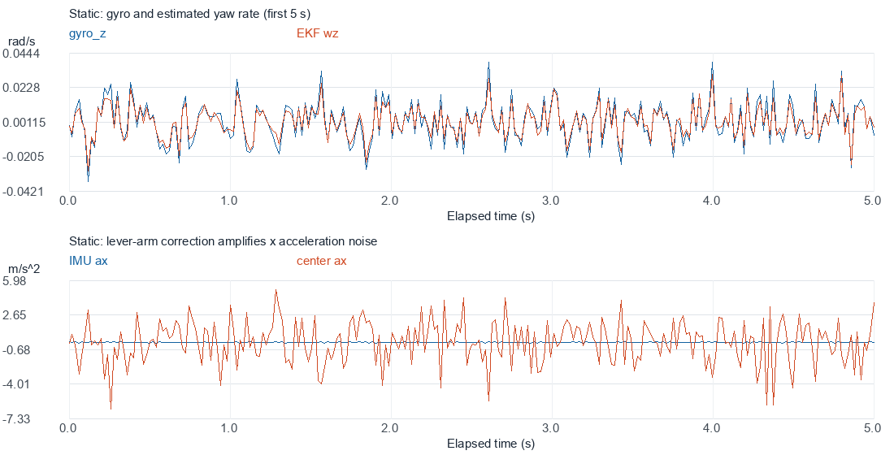
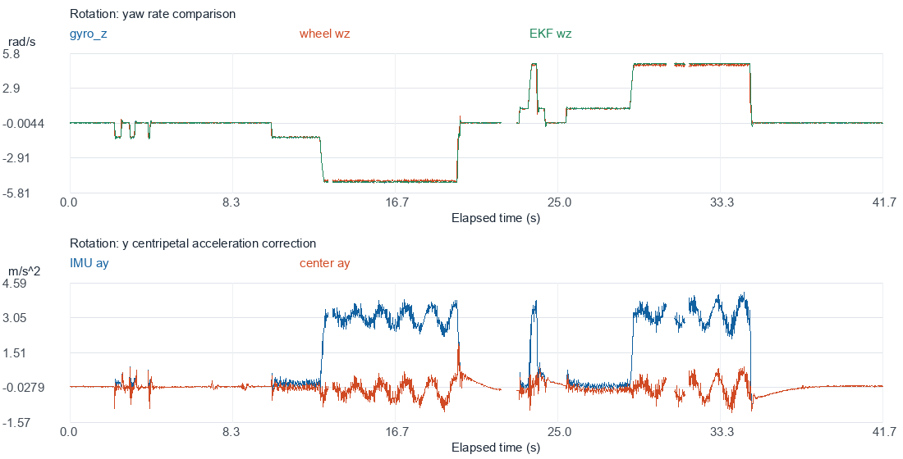
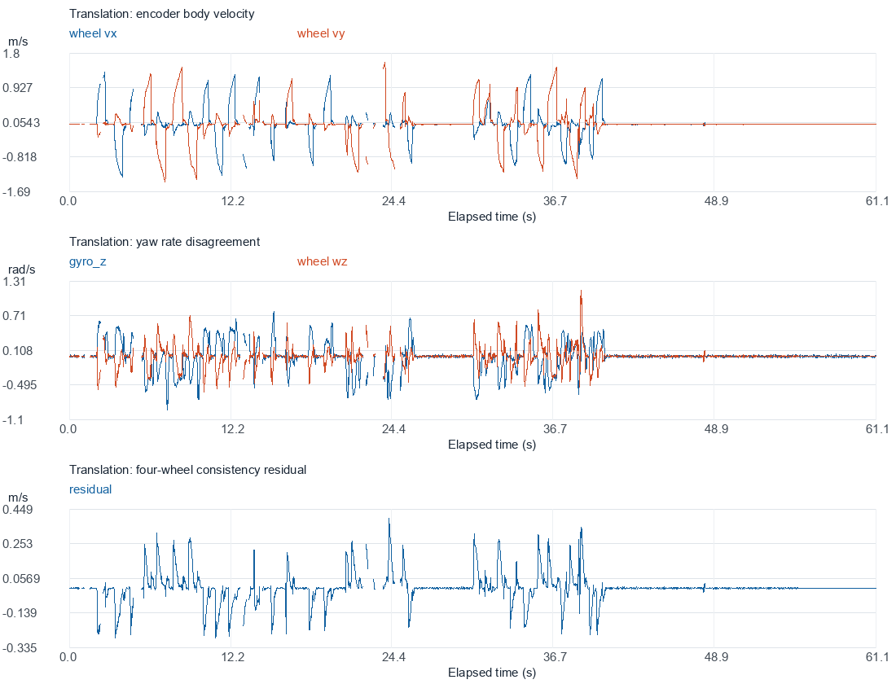

# 2026-10-12 速度观测器噪声分析

本次完成了三份实机日志的统计标定和动态一致性检查。静止记录包含其他机构的工作振动，因此保留全部有限样本，不通过删除振动峰值获得更小的噪声。用户确认动态测试时四轮落地、带实际负载，平动包含前后左右，转动绕底盘中心。

版本说明：本报告记录的是改进前“直接差分角速度”的实测结果。后续已按用户要求加入匹配低通，见 [速度融合说明](../../速度融合说明.md)；该版本仍待重新实测，本报告的旧方差和候选参数不代表新版标定结果。

**已得到当前工作状态下的 IMU 噪声基线；轮速观测噪声和过程噪声尚不能唯一确定。本次没有修改固件参数、滤波实现、PID 或 Modules 层，也没有烧录。** 当前结果仅适用于本次机构状态、安装位置、约 39.5°C 温度和现有信号处理流程。

## 1. 数据质量与时间基准

| 日志 | 有效行数 | 记录时长 | 缺失 20 ms 时隙 | 缺失比例 | 最大相邻记录间隔 |
| --- | ---: | ---: | ---: | ---: | ---: |
| 静止.csv | 7564 | 151.2600 s | 0 | 0 | 0.0214 s |
| 平动.csv | 2877 | 61.1201 s | 180 | 5.89% | 0.6200 s |
| 转动（包括顺逆时针）.csv | 2005 | 41.6801 s | 80 | 3.84% | 0.8203 s |

三份数据都是 25 通道，无 NaN/Inf。状态位显示所记录时刻 gyro、中心加速度、观测器更新和融合反馈均有效，四电机在线，速度外环启用，底盘未处于 POWER_OFF。约 0.29%～0.50% 的记录时刻没有同时满足四轮“新样本”条件；不能据此认为四轮离线。记录之间的状态不可从这些快照推断。

静止温度为 39.500～39.625°C，转动最高 39.750°C。本次只覆盖一个稳定温区，不能标定完整温漂曲线。

CSV 时间间隔约 20 ms，来自通道 1。通道 2 是被抽取那一轮 EKF 的约 1 ms 步长，**不能用作 CSV 相邻行的时间间隔**。INS 计数通常每行增加约 20，说明实际 IMU 高频运行，CSV 为 50 Hz 快照。动态记录存在断点，绘图在断点处断线，不插值。

缺失时隙可能来自发送跳帧、任务调度或 PC 记录，日志不足以确定是哪一种，更不能直接认定无线链路故障。静止幅度统计完整；动态间隙附近不适合辨识时延。

## 2. 静止段：可直接估计的工作噪声

采用去均值样本方差：`s² = Σ(x-mean)²/(N-1)`。表中均值单独列出，不并入随机方差。静止包含机构振动，数值是当前工况的有效波动，不是 BMI088 芯片自身噪声规格。

| 信号 | 均值 | 标准差 σ | 样本方差 σ² | 单位 |
| --- | ---: | ---: | ---: | --- |
| gyro_x | 0.00007567 | 0.0090763 | 8.23790e-5 | rad/s；方差为 (rad/s)² |
| gyro_y | -0.00012454 | 0.0115418 | 1.33212e-4 | rad/s；方差为 (rad/s)² |
| **gyro_z** | **0.00001200** | **0.0125839** | **1.58354e-4** | rad/s；方差为 (rad/s)² |
| IMU 点 ax | 0.0004082 | 0.0298425 | 8.90575e-4 | m/s²；方差为 (m/s²)² |
| IMU 点 ay | 0.0003038 | 0.0122259 | 1.49471e-4 | m/s²；方差为 (m/s²)² |
| **中心 ax，实际预测输入** | **0.0062516** | **2.0419267** | **4.1694646** | m/s²；方差为 (m/s²)² |
| **中心 ay，实际预测输入** | **0.0002826** | **0.0122268** | **1.49494e-4** | m/s²；方差为 (m/s²)² |

把静止记录等分为八段，每段约 18.9 s，gyro_z 标准差约 0.0122～0.0130 rad/s，中心 ax 标准差约 1.89～2.11 m/s²，波动量级持续存在。不是少数离群点造成的结果。

gyro_z 均值仅约 1.2e-5 rad/s，远小于单次波动；不能凭这一份记录认定它是稳定、需要再扣除的零偏。驱动已执行启动零偏扣除，本次不叠加新的均值补偿。IMU 点 az 的残余均值约 -0.108 m/s²，可能包含姿态、重力去除及标定残差，当前平面速度 EKF 不直接使用该轴。

静止轮速几乎全部量化为零，vx/vy 方差约 6.35e-11、wz 方差约 6.70e-10。**这不足以代表运动中轮速精度，不能据此将 wheel_variance 调到接近零。**



### x 方向噪声为何被放大

当前 IMU 位置为 `r=(0,-0.1335) m`，补偿关系为：

```text
center_ax = imu_ax - 0.1335 * angular_accel
center_ay = imu_ay - 0.1335 * wz²
angular_accel = (gyro_z_now - gyro_z_previous) / actual_gyro_interval
```

从 `(center_ax-imu_ax)/(-0.1335)` 反推出补偿实际使用的角加速度，其静止标准差约 **15.30 rad/s²**。中心 ax 的标准差为补偿前的 **68.4 倍**，方差约为 **4682 倍**。

代码中的角加速度直接由约 1 ms 间隔的 gyro 差分获得；IMU 点加速度则已经过现有约 8.5 ms 时间常数的低通。差分放大高频变化，两路带宽和相位也不同。机构的真实角振动、陀螺仪测量噪声和这种带宽不匹配都可能参与，因此不能把补偿项全部认定为芯片噪声。

问题位于应用层 `chassis.c::EstimateSpeed()` 的输入处理，杆臂补偿的几何公式本身与当前坐标定义一致。优先改进方向是对角加速度估计和加速度输入做带宽/相位一致性处理，并重新采集验证。可在底盘应用层完成，无需改 Modules。不能直接根据这份 50 Hz 快照指定最佳截止频率，也不建议完全删除转动时必要的杆臂补偿。

中心加速度 x/y 协方差约 1.32960e-4，对应相关系数约 0.0053，静止时跨轴相关很小。但 IMU 点 ax 的 20 ms 一阶自相关约 -0.578，说明振动和现有滤波使信号并非理想独立白噪声。50 Hz 快照不足以识别完整高频频谱，下面的方差应当视为有效噪声近似。

## 3. 动态检查

### 原地转动：符号和尺度基本一致

全转动记录中，选择 `|gyro_z|>0.1 rad/s` 的样本，gyro_z 与 wheel_wz 的相关系数约 0.9983。进一步选取连续 21 个采集时隙、窗口内 `|gyro_z|>1` 且峰峰值小于 0.12 rad/s 的相对稳定转动段，得到 689 点：

```text
gyro_z ≈ 1.02015 * wheel_wz + 0.00438 rad/s
相关系数 = 0.999889
拟合残差 RMS = 0.06256 rad/s
直接 gyro_z-wheel_wz 的 RMS = 0.10408 rad/s
```

正、负方向分别拟合的斜率为 1.02110 和 1.01936，方向一致。**本组转动没有支持 √2 倍尺度误差的证据**；约 2% 的差异也不能直接判定由轮径、安装半径或陀螺仪哪一项造成。本组检查不能单独证明 vx/vy 的绝对尺度准确。

相对稳定转动段中 `imu_ay` 对 `gyro_z²` 的拟合斜率约 0.13144 m，截距约 -0.10387 m/s²，与配置的 0.1335 m 杆臂量级一致。不能因此直接把位置改成 131.44 mm：拟合仍含振动、姿态/重力误差及中心的微小运动。

补偿后中心 ay 在这段数据中的均值约 -0.14074 m/s²，标准差约 0.34384 m/s²；二阶矩约 **0.1380 (m/s²)²**，远大于静止方差。说明只使用静止的 1.49e-4 作为所有运动工况下的输入不确定度过于乐观。它也不等于纯测量噪声，可能包含真实中心振动和模型误差。



### 平动：轮速与陀螺仪存在运动相关差异

前后左右平动时，轮速正解覆盖 vx 约 ±1.32 m/s、vy 约 -1.45～1.56 m/s。gyro_z 范围约 -0.93～0.79 rad/s，wheel_wz 范围约 -0.62～1.15 rad/s。

在 `|gyro_z|>0.1` 的 868 个样本上，两者差值 RMS 约 **0.54274 rad/s**，相关系数约 **-0.346**。此处差异明显大于静止噪声，不能解释为普通陀螺仪随机抖动，也不能根据它单独判定 wz 极性反了，因为原地顺逆转动的符号已一致。

四轮一致性残差的标准差，平动整段为 **0.07881 m/s**，转动整段为 **0.00999 m/s**，相差约 7.9 倍。可能涉及平动打滑、轮组接触/受力、几何和安装偏差、速度反馈不同步及滤波延迟。需要结合轮组检查和独立参考才能定位；本次不直接归因于某个电机。

残差只反映冗余轮速约束的一个方向，四轮共同尺度误差等问题可能不出现在残差中。不能把残差方差直接填入 vx、vy、wz 三个轮速观测方差。



## 4. 参数建议及其边界

当前实现的预测协方差使用 `process_noise[i]*dt`，加速度不确定度使用 `accel_variance[i]*dt²`，gyro/wheel_variance 是每次观测的方差。加速度进入状态预测，`accel_variance` 并不是一个直接平滑加速度的滤波器。

| 参数 | 当前值 | 数据结果 / 建议 | 解释 |
| --- | --- | --- | --- |
| gyro_variance | 0.0004 | 静止测得 0.00015835；基线建议 **0.0002** | 给本次工作振动保留适度余量，单位 (rad/s)² |
| accel_variance[0] | 0.25 | 静止测得 4.16946；当前算法基线建议 **4.5** | 反映现有角加速度差分的放大；修复后必须重新标定 |
| accel_variance[1] | 0.25 | 静止测得 0.00014949；静止基线约 **0.0002** | 不建议直接作为运动时固定值 |
| accel_variance[1] 动态试验值 | 0.25 | 可先试 **0.15** | 依据稳定原地转动二阶矩约 0.138 留余量，属于保守有效不确定度，不是唯一标定值 |
| wheel_variance | {0.01,0.01,0.04} | 本轮保留 | 缺乏独立真值；静止量化和运动相关误差无法唯一分离 |
| process_noise | {0.5,0.5,1.0} | 尚未完成标定 | 包含模型、滑移及未建模运动，静止幅度不能唯一确定 |
| initial_variance | {0.25,0.25,0.25} | 本轮保留 | 日志不包含足够的启动估计误差证据 |

若后续只进行参数试验、保持现有输入算法，建议候选组合为 `gyro_variance=0.0002`、`accel_variance={4.5,0.15}`。这是**待验证候选**，不能称为已经标定好的整套 Q/R，也没有在本轮写入配置。

### 为什么只改这些数值不一定更平稳

1. `wz` 当前 q=1.0，相比单次 gyro 方差较大。在简化的 1 kHz 标量稳态模型中，假设每轮同时校正轮速和 gyro、无跨轴耦合，当前 gyro 增益约 0.759；仅将 gyro_variance 从 0.0004 降到 0.0002，增益升至约 **0.850**，会更跟随本次 gyro 测量。实测静止 EKF wz 标准差为 **0.01008 rad/s**，gyro 为 0.01258，输出仍保留较多波动。
2. 同一简化模型中，保持 Rgyro=0.0002，q_wz 取 0.02 和 0.005 时 gyro 增益约 0.269 和 0.146。这只是参数敏感性示例，不能凭增益小就认定动态效果更好；需要验证转动起停时延和外环响应。它们没有写入固件。
3. 以 dt=1 ms 为例，当前 q_vx*dt=5e-4；把 accel_variance_x 从 0.25 改成 4.5，加速度方差项只从 2.5e-7 增到 4.5e-6，仍远小于过程项。并且噪声加速度仍直接进入速度预测。**修正方差无法替代对角加速度差分本身的处理。**

不使用 50 Hz 日志伪造 1 kHz 完整回放结果；高频测量和中间更新未被记录，快照无法精确复现当前固件的 EKF。

## 5. 建议执行顺序

1. 先在底盘应用层改善角加速度估计及杆臂补偿的信号带宽一致性，保持现有 Modules 接口。检查补偿在正负转动、起停时的符号、幅值和延迟。
2. 改动后再录一组同工况静止及原地转动数据，重算实际 center_ax/ay 方差，然后更新对应输入噪声；本报告的 4.5 只适用于当前差分算法。
3. 同步检查平动时四轮一致性，并增加独立参考：定距/定时的匀速 vx、vy，多方向重复；固定转角/时间或外部姿态用于角速度尺度。要获得随时间的动态误差，优先使用可同步的外部定位/测速。
4. 基于这些证据整定 q_vx、q_vy、q_wz，比较静止抖动与动态滞后，随后再整定三轴速度外环。当前速度外环已经启用，后续对比应记录是否关闭外环，避免控制动作改变采集工况。

## 6. 复现与产物

分析脚本：[calibrate_omni_noise.py](../../../../../../../Utils/analysis/calibrate_omni_noise.py)，依赖 numpy、reportlab、Pillow。示例（在仓库根目录执行）：

```powershell
python Utils/analysis/calibrate_omni_noise.py `
  --static 'C:/Users/Dai/Desktop/静止.csv' `
  --translation 'C:/Users/Dai/Desktop/平动.csv' `
  --rotation 'C:/Users/Dai/Desktop/转动（包括顺逆时针）.csv' `
  --output UserApp/components/chassis/chassis_omni/speed_observer/noise_calibration/2026-10-12
```

- [results.json](results.json)：原始路径、SHA256、状态、完整统计、拟合及候选参数。
- [channel_statistics.csv](channel_statistics.csv)：三组日志各通道的均值、标准差、方差和范围。
- PNG 图已嵌入本报告；同名 SVG 文件保留可缩放版本。
- 原始 CSV 保持在用户桌面，没有改写或复制到仓库。

脚本已运行，并核对通道映射、时间/计数、样本方差与拟合；三张 PNG 已做视觉检查。本轮为数据分析和文档修改，未重新编译、烧录或进行新实机试验。报告中的候选参数没有得到改动后硬件验证。
