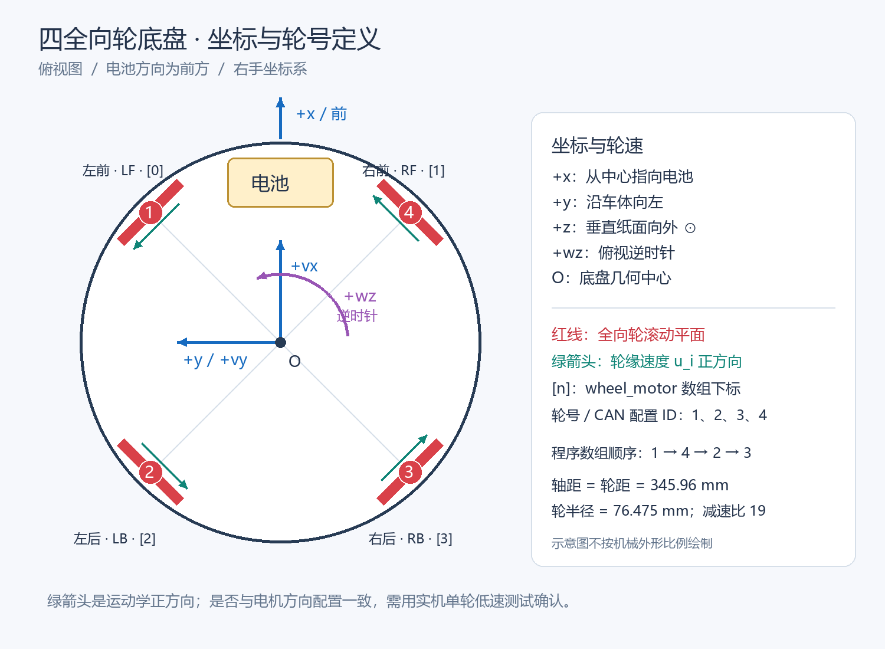

# 四全向轮底盘：坐标定义与运动学解算

适用机器人：`sentry_omni_chassis`；底盘组件：`chassis_omni`。更新日期：2026-10-11。

本文按实际机器人手绘布局定义：四个普通全向轮位于正方形四角，滚动方向沿以底盘中心为圆心的圆周切向。电池所在方向为车头。红线表示全向轮的滚动平面在俯视图中的方向，不是电机轴线，也不是麦克纳姆轮的滚子方向。

## 1. 定义图



图中的绿箭头表示每个轮子的**正轮缘速度对应的车体运动方向**。它不表示接触点相对轮心的材料运动方向，后者与车辆滚动方向相反。所有绿箭头均沿绕中心逆时针的切向，因此四轮速度同为正时产生正角速度。

轮号按实物编号；方括号是程序数组下标。这两种编号不能混用。

| 实物轮号 / 电机配置 ID | 位置 | 简称 | `wheel_motor[]` 下标 | 轮心坐标 (x,y) |
|---|---|---|---|---|
| 1 | 左前 | LF | 0 | (+a,+b) |
| 2 | 左后 | LB | 2 | (-a,+b) |
| 3 | 右后 | RB | 3 | (-a,-b) |
| 4 | 右前 | RF | 1 | (+a,-b) |

**程序中所有四轮向量都按 `[1,4,2,3] = [LF,RF,LB,RB]` 排列。** 配置里的电机 ID 1～4 是 DJI 驱动使用的电机编号，不是直接发送的 CAN 帧仲裁 ID。

## 2. 坐标、参考点与单位

- 原点 O：底盘几何中心，也是假定的旋转中心。
- +x：从 O 指向电池所在前方；+y：沿车体向左；+z：向上。
- +wz：绕 +z 的右手正转，俯视为逆时针。
- vx、vy：原点 O 的平移速度，单位 m/s；wz：角速度，单位 rad/s。
- 电机目标和 `measure.speed_aps`：电机转子轴角速度，单位 °/s；不是 rpm，也不是减速后轮轴角速度。
- 配置中的几何长度仍使用 mm，初始化运动学时乘 0.001 转为 m。

| 参数 | 配置值 | 进入公式的值 |
|---|---:|---:|
| 前后轴距 | 345.96 mm | 2a = 0.34596 m |
| 左右轮距 | 345.96 mm | 2b = 0.34596 m |
| 轮子半径 r | 76.475 mm | 0.076475 m |
| 减速比 G | 19 | 电机转速 / 轮子转速 = 19 |
| 中心至轮心距离 L | 由轴距、轮距计算 | 0.244630662 m |

这里轴距、轮距应测量**轮心之间的距离**，不是底盘外壳尺寸。当前参数沿用已确认配置。

本解算不使用 `center_gimbal_offset_x/y`：它们是云台位置参数，不能直接拿来改变以底盘中心为参考点的轮子力臂。云台系指令只改变平移向量的朝向，仍表示底盘中心速度。如果未来需要控制云台偏置点本身的速度，应另做刚体参考点转换。

## 3. 从刚体运动推导单轮速度

底盘中心速度为 `(vx,vy)`，角速度为 `wz`。坐标为 `(x_i,y_i)` 的轮心，其平面速度是：

```text
轮心速度 v_ix = vx - wz × y_i
轮心速度 v_iy = vy + wz × x_i
```

第一项来自底盘整体平移；第二项来自绕 O 的旋转，即 `ω × r_i`。

普通全向轮只能在自己的主动滚动方向提供驱动，垂直方向由小滚子允许自由滚动。因此需要将轮心速度投影到该轮的正滚动单位向量 `t_i`：

```text
u_i = t_ix × (vx - wz × y_i) + t_iy × (vy + wz × x_i)
```

其中 u_i 为有符号轮缘速度，单位 m/s。

对于圆周切向安装、正方向取逆时针切向：

```text
L   = sqrt(a² + b²)
t_i = (-y_i/L, x_i/L)
```

因此每个轮子的旋转投影都是 `+L × wz`。当前正方形 a=b，两个平移投影系数的绝对值都是 `1/√2`。

## 4. 逆运动学：底盘速度 → 四轮速度

先按实物轮号写出当前正方形底盘的四个公式：

```text
u1 = (-vx + vy)/√2 + L×wz     左前
u2 = (-vx - vy)/√2 + L×wz     左后
u3 = (+vx - vy)/√2 + L×wz     右后
u4 = (+vx + vy)/√2 + L×wz     右前
```

注意，代码数组形式为：

```text
[u1]   [-1/√2  +1/√2  L] [vx]
[u4] = [+1/√2  +1/√2  L] [vy]
[u2]   [-1/√2  -1/√2  L] [wz]
[u3]   [+1/√2  -1/√2  L]
```

对应 `OmniInverse()`。函数还支持轮心位于矩形四角、且轮子仍沿对应圆周切向安装的情形：vx 系数绝对值为 b/L，vy 系数绝对值为 a/L。若实际轮子始终固定在 45°，却只修改轴距或轮距，就不再满足这一模型。

### 4.1 轮缘速度转成电机速度目标

```text
轮轴角速度 [rad/s] = u_i / r
电机角速度 [rad/s] = G × u_i / r
电机角速度 [°/s]   = G × u_i / r × 180/π
```

定义 `K = G/r × 180/π`，当前 `K ≈ 14234.9763`，即轮缘速度 1 m/s 对应电机轴速度约 14234.98 °/s。

`OmniInverse()` 返回的就是电机 °/s，可直接交给 `DJIMotorSetPIDRef()`。该函数执行已有的电机速度 PID，随后进行功率限制，最终通过 CAN 发送电流指令。底盘速度不是直接作为电流发送。

### 4.2 三个基准例子

以下均为限制前的理论电机目标，顺序是程序数组 `[1,4,2,3]`：

| 底盘目标 | 四个电机目标 (°/s) |
|---|---|
| vx=1 m/s，vy=0，wz=0 | [-10065.65, +10065.65, -10065.65, +10065.65] |
| vx=0，vy=1 m/s，wz=0 | [+10065.65, +10065.65, -10065.65, -10065.65] |
| vx=0，vy=0，wz=1 rad/s | [+3482.31, +3482.31, +3482.31, +3482.31] |

当前保留已有 PID 输出限幅和功率限制。目标速度并不保证总能达到：负载、电压、功率限制、轮地打滑都会造成目标与实际速度不同。

### 4.3 为什么要有 1/√2

平移速度沿与轮子滚动方向夹角 45° 的方向运动时，投影大小为 `v×cos45° = v/√2`。这个系数来自几何投影。

旧代码缺少这个投影，同时还使用 `NAV_SPEED_SCALE=10000` 等经验量，因此旧系统的实际速度误差不能单独归结为“必定相差 √2”。现在直接从 m/s、rad/s 出发，经几何投影、轮半径和减速比得到电机 °/s，不再依赖导航经验倍率。

## 5. 正运动学：实测四轮速度 → 底盘速度

先把方向已校正、滤波后的电机反馈 `speed_aps` 转为轮缘速度：

```text
u_i = motor_speed_i / K
```

正方形底盘的正解为：

```text
vx = (-u1 - u2 + u3 + u4) / (2√2)
vy = (+u1 - u2 - u3 + u4) / (2√2)
wz = (+u1 + u2 + u3 + u4) / (4L)
```

对应 `OmniForward()`。对切向安装的矩形底盘，前两式的分母分别为 `4b/L` 和 `4a/L`。

四个轮速对应三个底盘自由度，存在一个冗余观测。上述正解是该对称布局下的等权最小二乘解。它能对冗余的轮速误差作投影，但不能自动识别哪个轮子打滑，也不能提供与地面无关的真实速度。

`EstimateSpeed()` 每次读取四个电机的 `measure.speed_aps`，调用正解，并更新：

```c
robot->chassis->speed_observer.wheel.vx; // m/s
robot->chassis->speed_observer.wheel.vy; // m/s
robot->chassis->speed_observer.wheel.wz; // rad/s
```

这是编码器推算的底盘机体系速度，未积分成位置。电机离线后反馈可能保持旧值；本次没有增加测速有效位或新的失效策略，不能把离线后的旧数据视为有效实时测速。四轮采样也并非硬件同步。

## 6. 电机方向约定

当前四个电机均保持原配置：`motor_reverse_flag=MOTOR_DIRECTION_REVERSE`，`feedback_reverse_flag=FEEDBACK_DIRECTION_REVERSE`。

方向处理分工如下：

```text
编码器原始转速 → DJI 驱动按配置反向 → 滤波后的 speed_aps → 运动学正解
运动学电机目标 → 速度 PID → 功率限制 → DJI 驱动按输出配置反向 → 电调
```

运动学使用的是驱动校正后的逻辑方向，不能再对反馈重复取反。

**手绘图能确认轮子位置与安装朝向，不能确认电机接线和传动后的实际正转方向。** 因此需实机逐轮核对：逻辑正目标应对应图中绿箭头的正滚动方向，逻辑反馈应为正。若不一致，应检查该轮的输入、反馈方向配置，不应靠任意修改 vx/vy/wz 的整体符号来掩盖。

## 7. 指令来源及函数调用关系

```text
RobotTask()
 ├─ navigator_send()                     现有上行协议，本次不扩展
 ├─ RobotCMDTask()
 │   ├─ DualBoardCtrlSet()                读取双板遥控数据
 │   ├─ CalcOffsetAngle()                 云台相对底盘的偏角，度
 │   ├─ RemoteControlSet()                选择遥控或导航输入
 │   ├─ 遥控旧档位 → SI 换算             导航 vx/vy 已经是 m/s
 │   └─ EmergencyHandler()               保留现有急停逻辑
 └─ ChassisTask()
     ├─ 电机停止/使能
     ├─ 局部 wz = 指令 wz + 角度环输出   不把叠加值写回原指令
     ├─ 云台系 → 底盘系平移转换          导航底盘系指令直接通过
     ├─ EstimateSpeed() → SpeedObserverUpdate()   更新 speed_observer.wheel
     ├─ SpeedHoldControl()                融合速度反馈，三轴速度 PID 修正
     ├─ OmniCalculate() → OmniInverse()   生成电机速度目标
     └─ LimitChassisOutput()
         ├─ DJIMotorSetPIDRef() × 4       电机速度 PID
         └─ PowerControl()               电流输出功率限制

MotorControlTask() → DJIMotorTask()       按现有周期发送电机电流指令
CAN 接收回调 → DecodeDJIMotor()          独立更新电机反馈
```

### 7.1 导航

导航 vx/vy 使用底盘机体系 m/s，直接赋值到同名变量，删除 `NAV_SPEED_SCALE`。导航发送 `vx=0.2` 就表示目标前进速度 0.2 m/s。

按此前约定，导航包中的 wz 仍不参与控制；实际旋转目标继续来自下位机拨轮或云台跟随。本次没有改变串口帧长度，也未新增测速上报字段。

### 7.2 遥控与角度跟随

遥控生成器仍保留原档位数值，在 `RobotCMDTask()` 进入底盘前作一次 SI 转换，导航平移不经过这个转换。对当前正方形配置：

```text
遥控旧平移量 → m/s：乘 √2/K
遥控旧旋转量 → rad/s：乘 (1000×π/180)/K
```

这样保持旧遥控档位产生的理想电机轮速参考。旧平移满量程 `60×660` 对应约 3.934 m/s；旧旋转档位 1000、4000 对应约 1.226、4.904 rad/s。这些是档位目标，不是实测速。

跟随 PID 的角度输入仍为度，增益及输出限幅按同一旋转换算系数转成 rad/s。当前 `enable_yaw_hold` 未启用；未来启用时，该 PID 的输出同样必须使用 rad/s。

未启用的 `MouseKeySet()`、`ModeControl()` 不属于当前运行链路；启用这些旧策略前需重新核对单位，尤其 `ModeControl()` 中尚有旧旋转档位增量。

### 7.3 云台系转换

offset_angle 是云台相对底盘的逆时针偏角，单位度。设转成弧度后的角为 θ：

```text
vx_body = cosθ × vx_gimbal - sinθ × vy_gimbal
vy_body = sinθ × vx_gimbal + cosθ × vy_gimbal
```

例如云台朝底盘左方（θ=+90°），云台系的正前进指令变为底盘系的正左移。导航指令已经处于底盘系，不进行这一步旋转。

## 8. 当前完成范围与验证

已实现 SI 逆运动学、编码器正运动学、导航单位接入及遥控目标的兼容换算。已接入速度 EKF，详见 [速度融合说明](speed_observer/速度融合说明.md)。按用户反馈的实机验证结果，现已配置启用陀螺仪观测和加速度预测；已接入 vx/vy/wz 整车速度外环，详见 [速度闭环说明](速度闭环说明.md)，新增导航上行 wz 字段尚未实现。

数学验证程序：`Utils/tests/test_omni_kinematics.c`。在仓库根目录使用宿主 GCC 编译运行：

```sh
gcc -std=c11 -Wall -Wextra Utils/tests/test_omni_kinematics.c -lm -o omni_test
./omni_test
```

检查内容：2000 组正方形/矩形切向几何投影与正逆解往返、三轴正方向、零输入，以及冗余轮速误差的投影。相关源文件已通过 STM32 ARM 编译；当前完整 Ninja 构建未完成，尚无完整链接和实车验证结论。

实车验收顺序：先核对四轮编号和正转方向，再分别给小幅纯 vx、纯 vy、纯 wz 指令，观察实际运动和 `speed_observer.wheel` 符号，最后用外部距离/时间和角度/时间测量检查尺度。轮速正逆解自洽不能替代实车尺度标定。

定义图生成脚本：`Utils/tests/draw_omni_definition.py`，使用 Pillow 绘制；插图随本文保存在 `images/omni_definition.png`，不依赖临时附件路径。
